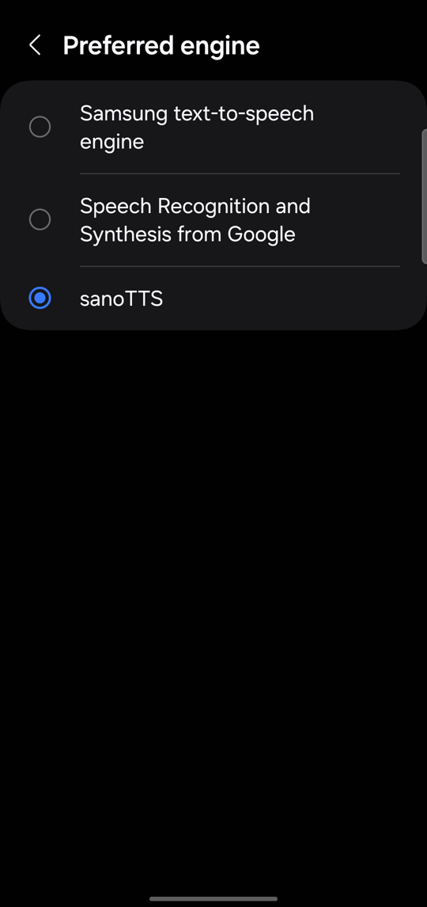
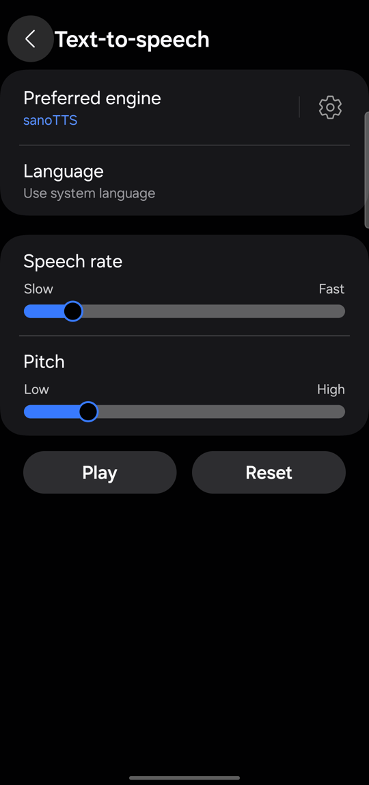
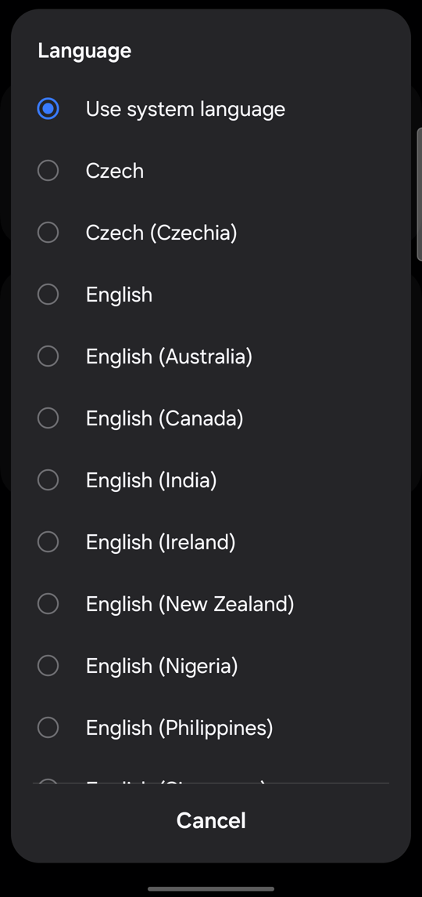
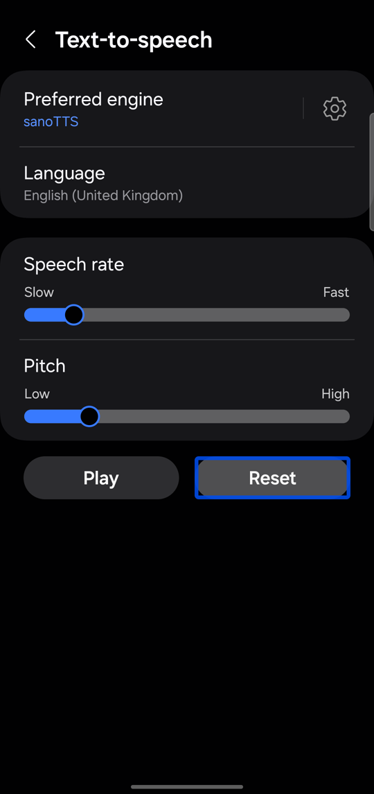

# sanotts-android

An Android text-to-speech engine (`TextToSpeechService`) that exposes
[sanoTTS](https://github.com/Ampixa/sanoTTS) voices as a system voice, so
TalkBack and any other app using the Android `TextToSpeech` API can speak with
them. Synthesis is on-device; the app requests no permissions, including no
network permission.

**Status: pre-alpha.** It speaks on a Samsung Galaxy A53 (Android 14),
including through TalkBack. Next: testing with blind and low-vision users, and
a faster start to speech. Details are under [Status](#status).

## Screenshots

On a Galaxy A53, Android 14:

| Chosen as the phone's voice engine | Text-to-speech settings | Languages | TalkBack reading the page |
| --- | --- | --- | --- |
|  |  |  |  |

## What is in it

* `app/src/main/java/.../SanoTtsService.java`: the engine. Splits text at
  sentence and clause boundaries, synthesises one piece at a time and streams
  16-bit mono 22050 Hz PCM to the framework, checking for a stop request
  between pieces.
* `app/src/main/java/.../CheckVoiceData.java`: answers
  `android.speech.tts.engine.CHECK_TTS_DATA` with the locales the engine
  speaks.
* `app/src/main/java/.../GetSampleText.java`: answers
  `android.speech.tts.engine.GET_SAMPLE_TEXT` with one sentence per language,
  for the Play button of the system settings.
* `app/src/debug/.../SpeakTestActivity.java`: debug builds only. Speaks a
  sentence through the engine and writes it to a WAV file, started from adb.
* `app/src/main/jni/sanotts_android.c`: JNI glue over the upstream C, which is
  compiled unmodified from `third_party/sanotts/` (espeak-ng phonemizer,
  duration + acoustic model, decoder).
* `app/src/main/assets/`: espeak-ng data and the voices.
* `tests/`: host-side check of the same C, and of the JNI entry points on a
  desktop JVM, against upstream's WebAssembly build.

## Languages and voices

One voice per language, all 22.05 kHz:

| Language | Android locale | Voice (upstream key) | Weights | Size |
| --- | --- | --- | --- | ---: |
| English (US) | `eng-USA` | amy | float32 | 5.6 MB |
| German | `deu-DEU` | german | float16 | 3.0 MB |
| French | `fra-FRA` | french | float16 | 3.0 MB |
| Spanish | `spa-ESP` | spanish | float16 | 3.0 MB |
| Italian | `ita-ITA` | italian | float16 | 3.0 MB |
| Portuguese (Brazil) | `por-BRA` | portuguese | float16 | 3.0 MB |
| Romanian | `ron-ROU` | romanian | float16 | 3.0 MB |
| Czech | `ces-CZE` | czech | float16 | 3.0 MB |
| Turkish | `tur-TUR` | turkish | float16 | 3.0 MB |
| Polish | `pol-POL` | polish | float16 | 3.0 MB |
| Vietnamese | `vie-VNM` | vietnamese | float32 | 6.0 MB |
| Indonesian | `ind-IDN` | indonesian | float32 | 6.0 MB |

A user whose locale is another country of one of these languages gets that
language's voice: en-GB, en-IN and the rest use the US English voice, es-MX
the Spain Spanish voice, pt-PT the Brazilian voice, fr-CA the France French
voice. The engine reports the language alone, the voice's own country, a list
of common countries (`VOICES` in `SanoTtsService.java`) and the countries of
the device's own locales.

"Ships" here means: for each of these, the C in this repository produces
phoneme ids identical to upstream's WebAssembly build and audio that matches
it (see [Status](#status)). It does not mean the voice has been heard on a
phone by a person. Upstream's README has word-error-rate figures for most of these voices
(Polish has none) and notes that no listening test has been run on any
non-English voice.

Not included, and why:

* **Russian**: needs a stress lexicon that upstream assembles per utterance in
  JavaScript; the full dictionary is 8.2 MB and is not in upstream's data set.
* **Arabic**: needs upstream's diacritizer, which exists only as a JavaScript
  port.
* **Chinese**: upstream's current voice uses a pinyin lexicon front end that
  exists only in JavaScript and Python.
* **Nepali, Hindi**: upstream's README describes them as browser-only. The
  same host check passes for both with this code, so adding them is a data
  and table change; it is left as a decision for the maintainers.
* **heart, heart-nano** (English, 24 kHz): a different runtime with a
  different phoneme front end; not wired up.

## Build

Requirements: JDK 17, Android SDK with `platforms;android-34`,
`build-tools;34.0.0` and NDK `27.2.12479018`.

```sh
./gradlew assembleDebug        # app/build/outputs/apk/debug/app-debug.apk
```

The Gradle build has not been run yet (see [Status](#status)). The APK
described below was produced by the equivalent manual pipeline, which also
packages the debug-only test activity:

```sh
ANDROID_HOME=/path/to/sdk tools/build-debug-apk.sh /path/to/outdir arm64-v8a
```

Host check (needs a C compiler and Python 3; Node.js and a sanoTTS checkout
only for the comparison against upstream):

```sh
node tests/wasm_reference.mjs /path/to/sanoTTS app/src/main/assets/voices /tmp/ref
python3 tests/host_test.py --reference /tmp/ref --jni     # --jni needs JAVA_HOME
```

## Install and select

```sh
adb install sanotts-debug.apk
```

1. Settings > Accessibility > Text-to-speech output (on Samsung: Settings >
   General management > Text-to-speech).
2. Preferred engine: choose **sanoTTS**.
3. Language: leave "Use system language", or choose one of the languages
   above.
4. Play speaks a sample sentence. TalkBack speaks with the preferred engine.

The engine applies the system speech rate. It ignores the pitch setting: the
runtime has no pitch control.

To test without changing the preferred engine (debug builds):

```sh
adb shell am start -n com.ampixa.sanotts.tts/.SpeakTestActivity --es lang es-MX
adb logcat -s SanoTTS SanoTtsTest
adb pull /sdcard/Android/data/com.ampixa.sanotts.tts/files/es-MX.wav
```

The engine logs to the `SanoTTS` tag: start-up, language queries, and for each
utterance its length, voice, synthesis time and audio length. It never logs
the text.

## Status

### On a device, 2026-11-18

One phone: Samsung Galaxy A53 5G (SM-A536E), Android 14, arm64, system locale
en-GB, debug APK 0.2.0, driven over adb.

* **It speaks.** For all 12 voices, and for en-GB, en-IN, es-MX, fr-CA and
  pt-PT, a client using the `TextToSpeech` API got `onStart` and `onDone`
  with no error, the audio server showed the engine's 22050 Hz player start
  and stop, and `synthesizeToFile` wrote a valid WAV of 2.3 to 4.3 s with
  speech-like levels.
* **System settings.** The engine is listed and can be selected; with the
  en-GB system locale, and with German or Spanish (Mexico) chosen, Play is
  enabled and plays the sample sentence.
* **TalkBack.** With Samsung TalkBack on and sanoTTS preferred, TalkBack's
  utterances reached the engine and were played while focus moved over one
  settings page (about 20 utterances, moved with key events).
* **Speed.** Synthesis takes 0.26 to 0.41 of the audio's duration. A piece of
  text is computed whole before any of it plays, so the time to first sound
  was 0.2 s for a 3-character item, 0.5 to 1.1 s for 21 to 24 characters,
  1.3 to 1.5 s for a 50-character English sentence (0.6 to 1.2 s in the other
  languages) and 3.6 s for the first piece of a 206-character announcement.
  Start-up takes 60 ms the first time and 21 ms afterwards; changing voice
  60 to 72 ms.

The automated run checked the logs, the player events and the WAV files
written on the phone, plus the host parity below. We have also listened to it
speaking on the phone.

What the first device run found and this version fixes:

* With a system locale such as en-GB the settings page greyed out Play and
  the sliders, because `CHECK_TTS_DATA` listed only `eng-USA` and Android
  wants the user's exact locale in that list.
* There was no `GET_SAMPLE_TEXT` activity; with a US English locale Play was
  enabled but silent.
* Voices are now declared explicitly (`onGetVoices`, `onGetDefaultVoiceNameFor`,
  `onLoadVoice`), one per language, so every country of a language resolves to
  the same voice.
* The engine logged nothing unless it failed.

### On a Mac (arm64), 2026-11-18

* **Host parity.** `tests/host_test.py` compiles the vendored C and
  `sanotts_android.c` natively and synthesises two sentences per voice. For
  all 12 voices: phoneme ids are identical to upstream's prebuilt WebAssembly
  modules, sample counts are identical, PCM correlation with the WebAssembly
  output is 1.000000, and the float16 voices widen to the sha256 recorded in
  their `meta.json`. Clips are 1.4 to 5.0 s, RMS 0.02 to 0.13.
* **JNI on a desktop JVM.** With `--jni`, the same test loads the app's own
  `Native` class and JNI entry points in a desktop JVM (OpenJDK 17) and gets
  PCM byte-identical to the C driver for all 12 voices.
* **APK.** A debug APK (47.7 MB, `arm64-v8a` only) is assembled with
  `tools/build-debug-apk.sh` and passes `apksigner verify`. It requests no
  permissions. The 0.2.0 APK reuses the native library built for 0.1.0 with
  NDK r27c (`PREBUILT_LIB_DIR`); the native sources have not changed.

### Known limits

* **Too slow to start speaking for a screen reader.** See the figures above;
  a mid-range 2022 phone needs over a second for a sentence. Cheaper phones
  will be slower. Upstream ships ~0.5 M-parameter variants of eight of the
  languages that could be substituted, and text could be cut into shorter
  first pieces.
* **A stop request takes effect between pieces of text** (up to 120
  characters), not inside one. When TalkBack moves on, the piece being
  computed is finished and thrown away before the next item starts, so quick
  navigation lags by up to the synthesis time of the interrupted piece.
* Not yet tested with blind or low-vision users.
* TalkBack was tested on one page, with key events. Touch gestures, long
  texts, other speech rates, the lock screen before first unlock, and battery
  use have not been tested.
* One phone, one Android version. `armeabi-v7a` and `x86_64` have not been
  built, so the APK does not install on 32-bit-only phones, which many
  low-cost devices are. `./gradlew assembleDebug` has not been run.
* A language change from a client waits for the utterance in progress, and a
  synthesis error in one piece abandons the rest of that utterance.
* One voice per language: British, Indian, Mexican, European Portuguese and
  Canadian French users hear the US, Spain, Brazil and France voices.
* The pitch setting is ignored. No settings screen, no launcher icon.
* Debug-signed only; an update installs only over a build signed with the
  same debug keystore.

## Licence

GPL-3.0-or-later; see [`LICENSE`](LICENSE). The copyleft comes from the
espeak-ng phonemizer, which is compiled into the native library. Upstream
releases part of its runtime under MIT, but the files used here are not among
them; see [`third_party/sanotts/README.md`](third_party/sanotts/README.md) for
the file-by-file provenance.

Copyright (C) 2026 Ampixa.
